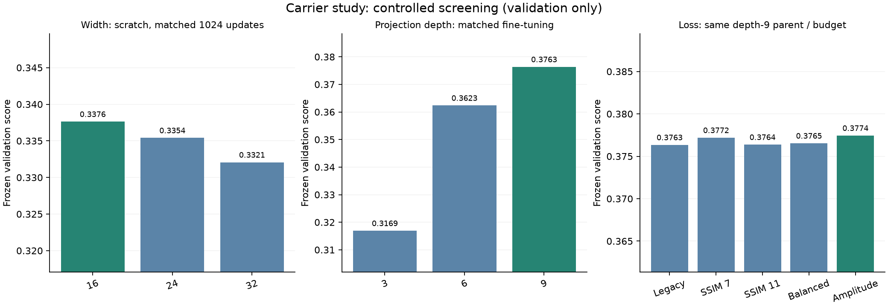
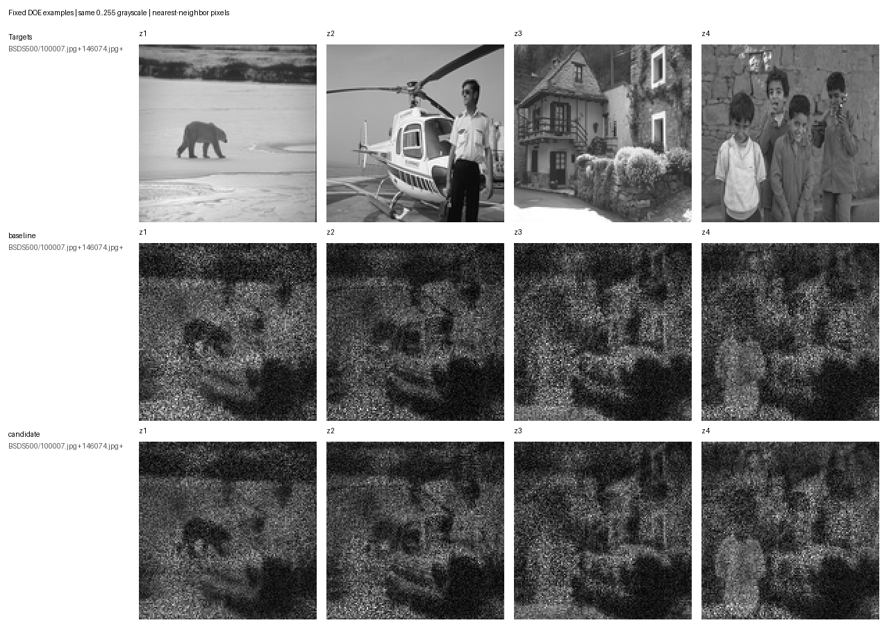

# Контролируемое исследование Carrier U-Net

Проведено 18 обучающих прогонов и итоговая оценка на 624 квартетах. Подтверждённое улучшение получено при ширине **16**, **9 физических проекциях**, сохранённых фазовых каналах и функции потерь с PCC, глобальным/оконным SSIM и масштабируемой ошибкой амплитуды. Рабочий Compose переключён после проверки заранее заданных условий.

Итоговый чекпойнт — `artifacts/doe-carrier-study-v1.pt`, версия `fresnel-unet-carrier-v1:d4176bb99d8c`, **484 197 параметров**. Исходный `doe-photo-carrier-v1.pt` сохранён для отката.

## Результат на закрытых данных

Выбор финалистов и порядок продвижения сохранены до открытия тестовых метрик в `runs/carrier-study-v1/finalists.json`. После тестовой оценки обучение не продолжалось. Физическая модель МИФИ, нормировка, квантование фазы и изображений оставались одинаковыми.

| Группа | Квартеты | Mean PCC | Mean Worst PCC | Global SSIM | Windowed 7×7 | Windowed 11×11 |
|---|---:|---:|---:|---:|---:|---:|
| Новый широкий тест | 256 | 0.44709 → **0.46118** | 0.29733 → **0.31220** | 0.31364 → **0.32550** | 0.17516 → **0.18540** | 0.19529 → **0.20588** |
| Внешние естественные изображения | 32 | 0.45496 → **0.47455** | 0.36750 → **0.38386** | 0.36794 → **0.38886** | 0.21656 → **0.23503** | 0.24702 → **0.26709** |
| Лица, диагностический | 10 | 0.55945 → **0.57876** | 0.48819 → **0.50054** | 0.46788 → **0.49023** | 0.16502 → **0.17801** | 0.21521 → **0.23157** |
| Mixed, диагностический | 5 | 0.64505 → **0.65921** | 0.54324 → **0.56172** | 0.48471 → **0.50221** | 0.18342 → **0.19534** | 0.21325 → **0.22690** |
| Четыре новых изображения | 1 | 0.42887 → **0.45130** | 0.38305 → **0.42706** | 0.32808 → **0.33446** | 0.18967 → **0.20548** | 0.21486 → **0.23051** |

Взвешенный тестовый балл: **0,354875 → 0,369879**, абсолютный прирост **0,015005**. Парный bootstrap для объединённых новых широких и естественных когорт: **[0.013764; 0.015600]** для прироста. Все 20 ограничений на средние и слабейшие результаты в четырёх основных группах пройдены с положительными изменениями.

Правило продвижения было зафиксировано в [конфигурации](../configs/carrier-study-v1.json): прирост сводного балла не менее 0,002, положительная нижняя граница интервала новых когорт, просадка средней PCC/Global SSIM/Windowed SSIM не более 0,003, Mean Worst PCC и p10 слабейшего PCC/SSIM — не более 0,005. Приоритет кандидата относительно depth-only контроля тоже задан до теста.

Основную часть прироста даёт увеличение глубины с 6 до 9. Вариант с повторением последнего физического слоя без обучения получил **0,368452** на тесте; дальнейшая оптимизация добавила ещё **0,001428**. Это следует учитывать при оценке вклада новой функции потерь.

## Проверенные гипотезы

| Сравнение | Условия | Лучшие баллы валидации | Вывод |
|---|---|---|---|
| Ширина 16 / 24 / 32 | С нуля, 8×128 обновлений, общий seed и батчи | 0,337626 / 0,335403 / 0,332069 | В данном коротком бюджете лучше 16 |
| Проекции 3 / 6 / 9 | Общий рабочий родитель, 6×96 обновлений | 0,316912 / 0,362348 / 0,376346 | Уверенное преимущество 9 |
| Fourier Bottleneck / контроль | Нулевой mix сохраняет начальную функцию; тот же родитель/батчи | 0,362921 / 0,362348 | Малый ранний прирост, слабее эффекта глубины |
| Фазовые каналы вкл. / выкл. | С нуля, одинаковые бюджеты и batch seed | 0,337626 / 0,343461 | Каналы не универсально полезны |
| Каналы после ещё 12×128 обновлений | Парное продолжение ширины 16 | 0,350515 / 0,353407 | Без каналов по-прежнему лучше среди scratch, но ниже рабочего warm-start |
| Legacy / Window7 / Window11 / Balanced / Amplitude | Один depth9 родитель, одинаковые 6×96 обновлений | 0,376346 / 0,377189 / 0,376375 / 0,376534 / 0,377443 | Продолжен Amplitude |
| Teacher two-stage / парный контроль | Те же фиксированные train-цели; 2 supervised +4 physics эпохи | 0,377443 / 0,377443 | Оба сохранили эпоху 0 |
| Продолжение Amplitude | 12×96, LR 0,00005 | **0,377556**, эпоха 9 | Выбран по валидации |

Сравнение ширин ограничено одинаковым коротким бюджетом, а не полной сходимостью. Нельзя утверждать, что ширина 24/32 вообще хуже: более крупным моделям может требоваться другое число обновлений. Их не отбирали для дальнейшего обучения из-за меньшего прогресса при большей стоимости.

Контекст фазовых каналов сохранён у итоговой модели, поскольку она дообучается от проверенного рабочего чекпойнта. Утверждение об обязательной пользе каналов не подтверждено scratch-ablation.



График использует отдельные шкалы Y для трёх режимов; их начальные веса и бюджеты различаются. Внутри каждой панели условия парных сравнений одинаковы. Вариант 9 мог сохранить начальный depth9 кандидат, если дальнейшее обучение ухудшало валидацию.

## Окно SSIM 11×11

Проверены равномерные окна 7×7 и 11×11, valid-усреднение, data_range=1, K1=0,01, K2=0,03, поправки выборочной ковариации 49/48 и 121/120. Гауссовские веса в этом сравнении не использовались. Значения и градиенты сопоставлены со scikit-image; погрешность значений на float64 меньше 1e−10. Размер окна функции потерь не меняет окно 7 в зафиксированном критерии выбора.

На валидации Window11 слегка повысил средний SSIM11: 0,229585 → 0,229906 относительно Window7, но ухудшил взвешенный Mean Worst PCC: 0,383695 → 0,378702. На внешнем естественном тесте SSIM11 у обученного Window7 составил **0,262897**, у Window11 — **0,261930**. Замена размера окна сама по себе не дала устойчивого улучшения.

## Функция потерь и обучение победителя

Для каждой плоскости:

`E = 1.5*(1-PCC) + 0.25*(1-GlobalSSIM) + 0.5*(1-WindowSSIM7)`
`    + 0.03*PeakNormalizedAmplitudeMSE + 2.0*FittedAmplitudeMSE + 0.1*BackgroundPower`

`FittedAmplitudeMSE` использует положительный масштаб `s = sum(A*T)/sum(A²)` и сравнивает `s*A` с целевой амплитудой. Это сглаживает влияние одного максимального пикселя, сохраняя точную нормировку по пику в экспортных метриках. Потери агрегируются как `0.75*mean(E) + 0.25*soft_worst(E)` с температурой 0,2. Перераспределение весов выбрано по градиентной диагностике только обучающих данных.

Победитель: рабочая ширина 16 и 6 проекций → 9 проекций с копированием параметров последнего слоя → Amplitude: 6 эпох × 96 батчей, LR 0,0002, выбранная эпоха 3 → продолжение 12×96, LR 0,00005, выбранная эпоха 9. AdamW, weight_decay 0,00001, cosine LR до 10%, batch 16. Все warm-start этапы сохраняют родительский вариант как допустимую эпоху 0.

В обычном батче 50% новых квартетов естественных обучающих изображений, 25% широкого replay, 25% новых сочетаний четырёх разных обучающих людей. Новый natural_bank содержит 3672 плоскости из Open Images, USDA и 200 оригиналов BSDS500 train. Fashion-MNIST остаётся только в широком replay. Это устраняет прежнее преобладание процедурных целей в каждом батче.

При выборе применяется одна валидация 407 квартетов: прежние broad — 128, новые broad — 256, BSDS val — 8, люди — 10, Mixed — 5. Групповые веса 0,25/0,25/0,30/0,15/0,05. Внутри группы score=0,35MeanPCC+0,20GlobalSSIM+0,20WindowSSIM7+0,15MeanWorstPCC+0,10MeanWorstGlobalSSIM.

256 offline-teacher квартетов подготовлены только из natural_bank с четырьмя разными исходными источниками. Каждый teacher оптимизировался по фазе 240 шагов Adam, начиная с замороженного предсказания сети. Все 256 улучшились: средний score **0,343814 → 0,435848**. Сохранённые фазы и реконструкции проверены через PNG на CPU. Несмотря на качество меток, контролируемое supervised+physics дообучение не обошло исходного кандидата. Учительские веса не используются в победившей модели.

## Задержка инференса

Одинаковый Windows CPU, 4 потока, batch 1, 10 прогревов и 50 измерений со случайным воспроизводимым чередованием моделей. Инициализация исключена. Полный синтез включает forward, фазовый PNG, Френель, PNG-реконструкции и глобальные метрики; HTTP не включён.

| Вариант | Параметры | Forward median / p90, мс | Полный синтез median, мс |
|---|---:|---:|---:|
| baseline | 484182 | 30.07 / 43.18 | 73.02 |
| candidate | 484197 | 36.93 / 58.82 | 90.40 |
| width24 | 1086830 | 35.86 / 62.59 | 97.75 |
| width32 | 1929862 | 41.49 / 71.05 | 113.74 |
| fourier | 514646 | 29.41 / 48.85 | 75.68 |
| depth3 | 484167 | 21.18 / 34.37 | 63.63 |

Новая модель медленнее исходной; прирост глубины увеличивает количество физических операций при практически том же числе параметров. Тайминги характеризуют этот компьютер и протокол.

## Четыре новых изображения

До инференса зафиксированы BSDS test100007,146074,207038,290035. Это отдельный квартет, исключённый из отбора и правила продвижения. Остальные 128 внешних тестовых оригиналов используются в 32 квартетах статистической проверки.



Порядок строк: цели, исходная модель, новый кандидат. Шкала 0–255 фиксирована, дополнительное повышение контраста и фильтрация не применяются.

| Плоскость | PCC | Global SSIM | Windowed7×7 | Windowed11×11 |
|---|---:|---:|---:|---:|
| 1 | 0.41363 → 0.45687 | 0.29236 → 0.28042 | 0.12156 → 0.13746 | 0.14296 → 0.15737 |
| 2 | 0.43366 → 0.42706 | 0.26320 → 0.27780 | 0.17894 → 0.19363 | 0.19505 → 0.20925 |
| 3 | 0.48512 → 0.49205 | 0.40850 → 0.38578 | 0.24581 → 0.25090 | 0.28425 → 0.28447 |
| 4 | 0.38305 → 0.42923 | 0.34827 → 0.39385 | 0.21237 → 0.23993 | 0.23720 → 0.27096 |

Выигрыш в среднем не гарантирует улучшения каждой метрики на каждой плоскости: у второго изображения PCC снизился, у первого и третьего снизился Global SSIM. Спекл и межплоскостные помехи остаются заметны.

## Ограничения и воспроизводимость

Использована прежняя одно-FFT модель Френеля МИФИ:128×128,532 нм,10 мкм, плоскости 24,1/25,3/26,5/27,7 мм. Метрики вычисляются по 8-битной фазе и 8-битным пиково-нормированным амплитудным реконструкциям. Калибровка на физической оптической установке в этом исследовании не проводилась.

Новый широкий тест содержит 256 квартетов/1024 различных исходных источника и исключает все зарегистрированные ранее тестовые источники. Новые естественные тесты —128 оригиналов BSDS test, отдельно от BSDS train/val и демонстрационного квартета. Источник — институциональное зеркало Berkeley BIDS, commit `a04b7c6c3a9f0ace74bf205c72a43d32e1c72722`. Контрольные суммы и URL внешнего квартета сохранены в [машинном отчёте](carrier-study-v1-results.json). Различные ID/хеши не доказывают отсутствие всех семантически похожих фотографий.

Bootstrap выполняется по парным квартетам, отдельно по новым broad/natural когортам,4000 выборок. Он не измеряет разброс между seed обучения. Проверено по одному seed в каждом парном этапе; интервалы двух финалистов не корректировались на множественные сравнения. Портретные 10 квартетов используют одних и тех же 4 людей; диагностические Mixed/старые broad переиспользуют источники. Поэтому результат характеризует проверенные распределения, а не универсальную гарантию на любое изображение.

Пройдены 65 модельных, обучающих, API и численных тестов; Ruff/diff-check проходят. Повторная полная оценка итогового артефакта на CPU тоже допускает продвижение: gain 0,015002, максимальное расхождение средних SSIM/PCC и MeanWorstPCC с CUDA меньше 0,00003. Рабочий API подтвердил версию, валидные фазовый и 4 реконструкционных PNG, iterations=0.

Нейрорежим вызывает модель один раз. Девять физических проекций являются фиксированными слоями внутри forward; оптимизатора фазы или внешней итеративной докрутки при инференсе нет. Offline-оптимизация разрешена только для обучающих teachers.

## Запуск выбранной модели

```sh
docker compose -f compose.yaml -f compose.carrier.yaml up --build
```

Для локального API задайте `DOE_CHECKPOINT=artifacts/doe-carrier-study-v1.pt`. Работающий Compose в исходном checkout использует read-only mount этого чекпойнта и образ `miffi2026_2-backend:carrier-study-v1`. Он построен от ранее работающего backend с заменой только пакета моделей; пользовательские изменения исходного checkout не перезаписывались.

Для отката работающего исходного Compose:

```sh
docker compose -p miffi2026_2 -f compose.yaml -f runs/compose-carrier-study-v1.rollback.yaml up -d --no-build
```

## Повторение эксперимента

Нужны исходные датасеты и проверенный previous cache из `runs/photo-quality-v2/data`. Использована CUDA-сборка PyTorch2.7.1+cu128 на RTX3050TiLaptop4GB. Добавьте `backend/src` и `backend/scripts` в PYTHONPATH и задайте `CUBLAS_WORKSPACE_CONFIG=:4096:8` для детерминированного обучения.

```sh
python backend/scripts/prepare_carrier_study.py --runs ORIGINAL_RUNS --previous runs/photo-quality-v2/data --output runs/carrier-study-v1/data
python backend/scripts/train_carrier_study.py --data runs/carrier-study-v1/data --output runs/example-width16 --name width16 --width 16 --epochs 8 --batches 128 --lr .001 --seed 20261114
python backend/scripts/train_carrier_study.py --data runs/carrier-study-v1/data --output runs/example-depth9 --name depth9 --width 16 --projections 9 --initialize artifacts/doe-photo-carrier-v1.pt --epochs 6 --batches 96 --lr .0002 --seed 20261115
python backend/scripts/evaluate_carrier_study.py --test runs/carrier-study-v1/data/test.pt --output runs/example-evaluation.json --model baseline=artifacts/doe-photo-carrier-v1.pt --model candidate=artifacts/doe-carrier-study-v1.pt --device cpu
```

Полные настройки 18 прогонов, их родительские SHA-256, начальные и лучшие метрики, кривые, градиентная диагностика, качество teachers, окончательная проверка и тайминги находятся в [JSON-отчёте](carrier-study-v1-results.json). Полные поквартетные результаты и каждый checkpoint сохранены в локальной игнорируемой Git папке `runs/carrier-study-v1/`.

Финальный протокол: [configs/carrier-study-v1.json](../configs/carrier-study-v1.json).

Контрольная сумма итоговых весов: `d4176bb99d8cf84fdd30ee226dddc9bfcdccd6be223f2fc61b7f542f8c2c7d0f`.
