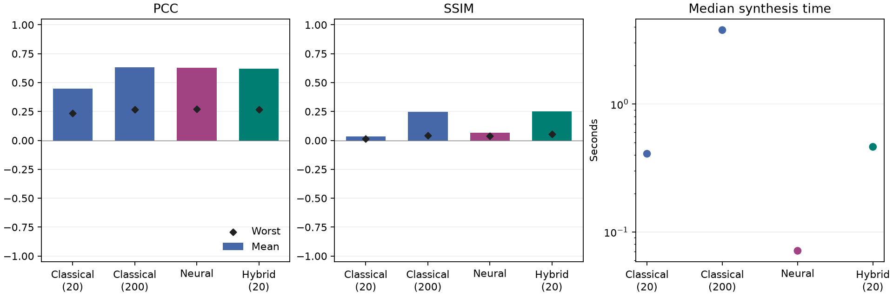

# Сравнение методов синтеза

Выборка `test`: 32 случаев, по четыре цели. Устройство — Intel64 Family 6 Model 154 Stepping 3, GenuineIntel.

| Метод (лимит шагов) | Среднее число шагов | Средний PCC | Средний SSIM | Худший PCC | Худший SSIM | Медиана, мс |
| --- | ---: | ---: | ---: | ---: | ---: | ---: |
| Classical (20) | 20.0 | 0.4464 | 0.0340 | 0.2347 | 0.0155 | 408.295 |
| Classical (200) | 200.0 | 0.6307 | 0.2462 | 0.2679 | 0.0417 | 3780.601 |
| Neural | 0.0 | 0.6280 | 0.0652 | 0.2731 | 0.0374 | 71.185 |
| Hybrid (20) | 20.0 | 0.6213 | 0.2517 | 0.2679 | 0.0555 | 462.188 |

Средние рассчитаны по всем наборам и плоскостям. Худшие значения — минимумы среди всех плоскостей и наборов. Время синтеза не включает загрузку весов, прогрев, экспорт PNG и расчёт метрик.

