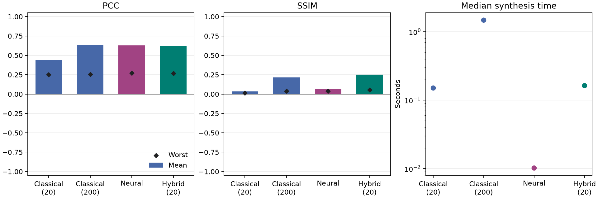

# Сравнение методов синтеза

Выборка `test`: 32 случаев, по четыре цели. Устройство — NVIDIA GeForce RTX 3050 Ti Laptop GPU.

| Метод (лимит шагов) | Среднее число шагов | Средний PCC | Средний SSIM | Худший PCC | Худший SSIM | Медиана, мс |
| --- | ---: | ---: | ---: | ---: | ---: | ---: |
| Classical (20) | 20.0 | 0.4428 | 0.0350 | 0.2531 | 0.0155 | 150.298 |
| Classical (200) | 200.0 | 0.6383 | 0.2141 | 0.2569 | 0.0376 | 1476.180 |
| Neural | 0.0 | 0.6280 | 0.0652 | 0.2731 | 0.0374 | 10.174 |
| Hybrid (20) | 20.0 | 0.6214 | 0.2517 | 0.2679 | 0.0555 | 162.560 |

Средние рассчитаны по всем наборам и плоскостям. Худшие значения — минимумы среди всех плоскостей и наборов. Время синтеза не включает загрузку весов, прогрев, экспорт PNG и расчёт метрик.

